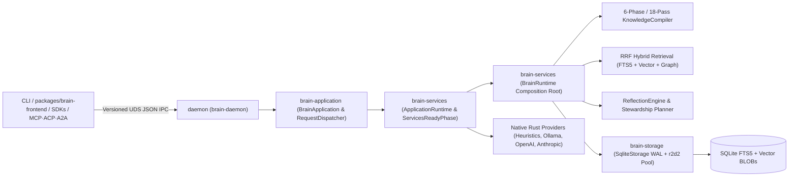

# Brain: System Architecture & Data-Flow Specification

This document covers Brain's runtime composition, workspace boundaries, compiler, retrieval, protocol and performance budgets. The [architecture references](docs/architecture/README.md) describe individual contracts and request flows.

---

## 1. System Topology & Runtime Composition

Brain operates as a local background daemon (`brain-daemon`) exposing a Unix Domain Socket (UDS) JSON-IPC interface to the first-party TypeScript/React terminal frontend (`packages/brain-frontend`), CLI (`apps/brain`), SDKs (`sdks/python`, `sdks/typescript`, `crates/brain-sdk-rs`), and stateless agent protocol adapters (MCP, ACP, A2A).

### Unified Composition Root (`DaemonHost::run_server`)
- **`apps/brain` CLI**: Delegates all `brain daemon {start|stop|status|run}` lifecycle operations directly to the `brain-daemon` binary.
- **`DaemonHost::run_server` (`daemon/src/host.rs`)**: Initializes a single authoritative `BrainRuntime::new(db_path)`, passes `Arc::clone(&brain_runtime)` into `ApplicationRuntime::builder().with_brain_runtime(...)` (which runs `ServicesReadyPhase` to wire native Rust LLM, embedding, and memory extraction providers driven by `BrainSettings`), and wraps it in `BrainApplication` (`crates/brain-application/src/application.rs`).

---

## 2. Workspace Layering (24 Cargo Members)

| Layer | Crates / Packages | Responsibility & Boundary Invariants |
| :--- | :--- | :--- |
| **1. Core Domain** | `crates/brain-domain` | Pure entities, aggregates (`KnowledgeGraph`, `Session`), value objects, specifications, and `DomainEvent` types. **Zero external async, DB, logging, or FFI dependencies.** |
| **2. Shared Contracts & Events** | `crates/brain-core`, `crates/brain-events`, `crates/brain-config` | Trait ports (`ChatAgent`, `EmbeddingProvider`, `MemoryExtractor`, repositories), `EventEnvelope` transport wrappers, and immutable `BrainSettings` / `RuntimePaths`. |
| **3. Persistence & State** | `crates/brain-storage`, `crates/brain-session`, `crates/brain-observability` | Sole owner of concrete SQLite connections (`rusqlite` + `r2d2`), WAL initialization, schema migrations, FTS5/vector repositories, session state, and `parking_lot`-backed diagnostics/metrics. |
| **4. Engine & Services** | `crates/brain-services`, `crates/brain-tools`, `crates/brain-plugins`, `crates/brain-python` | `BrainRuntime`, `ApplicationRuntime`, 18-pass `KnowledgeCompiler`, RRF retrieval, `ReflectionEngine`, native `HeuristicExtractor` & `reqwest` LLM/embedding providers. `brain-services` integrates the Python bridge through its `python-plugins` feature. |
| **5. Application Facade** | `crates/brain-application`, `crates/brain-integrations` | Capability-oriented `BrainApplication` orchestrator, `RequestDispatcher`, versioned v1 DTOs, and Specta TypeScript contract generation. |
| **6. Transport, CLI & Adapters** | `daemon`, `apps/brain`, `crates/brain-sdk-rs`, `crates/brain-cli-adapter`, `crates/brain-adapter-core`, `crates/brain-mcp-adapter`, `crates/brain-acp-adapter`, `crates/brain-a2a-adapter` | Stateless UDS/HTTP daemon server, CLI launcher, Rust client SDK, and MCP/ACP/A2A protocol translators. Protocol adapters consume versioned contracts. |
| **7. Presentation & SDKs** | `packages/brain-frontend`, `sdks/python`, `sdks/typescript` | First-party TypeScript terminal UI connected over versioned UDS, with typed state adapters and view models beneath presentation. |
| **8. Verification Gates** | `crates/brain-arch-tests`, `crates/brain-fitness-tests`, `xtask` | Automated dependency-DAG boundary checks, toolchain contract checks, and `cargo xtask verify`. |

---

## 3. Core Engine Pipelines

### 3.1 Six-Phase (18-Pass) Deterministic Knowledge Compiler (`crates/brain-services/src/compiler/`)
No background worker or transport handler may directly mutate canonical graph state outside the deterministic compiler and reflection command boundaries (`PassManager::default_pipeline()`):
1. **Structural Phase**: Observation normalization.
2. **Semantic Phase**: Alias resolution, entity merge, canonical entity resolution (deterministic tie-breaking: highest confidence -> latest provenance timestamp -> lexicographically smallest ID), confidence aggregation, provenance merge, fact deduplication, temporal fact resolution, canonical fact selection, relation normalization, contradiction detection.
3. **Graph Optimization Phase**: Relation deduplication and transitive reduction.
4. **Evidence Optimization Phase**: Provenance compression.
5. **Retention & Lifecycle Phase**: Dead-fact elimination, unreachable-entity pruning, confidence pruning.
6. **Validation Phase**: Graph invariant validation ($P(P(G)) = P(G)$ idempotency).

### 3.2 Native Extraction & Provider Pipeline (`crates/brain-services/src/extraction/` & `providers/`)
- **`HeuristicExtractor` (`heuristics.rs`)**: 100% deterministic Rust extractor with 33 synonym mappings, 61 stop words, type precedence hierarchy, proper-noun splitting, active/passive sentence relation rules, and referential-integrity edge pruning (zero dangling edges or self-loops).
- **`LlmMemoryExtractor` (`llm.rs`) & Native Providers (`providers/`)**: Native `reqwest` implementations for Ollama (`OllamaLlmProvider`, `OllamaEmbeddingProvider` with `/api/embed` to `/api/embeddings` fallback), OpenAI (`OpenAiLlmProvider`, `OpenAiEmbeddingProvider`, `OpenAiCompatibleEmbeddingProvider`), and Anthropic (`AnthropicLlmProvider`). All providers return typed `Result<_, BrainError>` without silent `[0.0; 384]` fallback vectors.

### 3.3 Hybrid Retrieval & Read-Model Projections
1. **Independent Candidate Channels**: SQLite FTS5 BM25 lexical search + vector similarity search over `f32` embedding BLOBs.
2. **Reciprocal Rank Fusion (RRF)**: Merges lexical and semantic rankings monotonically.
3. **Request-Scoped Graph Expansion**: Optional post-retrieval N-hop subgraph and relationship expansion (`NeighborhoodProjector`, `PathProjector`, `ClusterProjector`, `TemporalProjector`) over lock-free `ArcSwap` projection snapshots.
4. **Generation Context**: `DefaultContextOrchestrator` combines FTS candidates, bounded one-hop expansion, and vector matches from the configured embedding provider when persisted vectors exist. It applies memory scope before ranking and gives visible nodes marked `pinned` or `constraint_subgraph` priority within the turn’s item and token budgets. The stream exposes an allowlisted summary of the assembled snapshot.

### 3.4 UDS Streaming, Recovery & Fleet Registry
- **Handshake & Stream Correlation**: Clients negotiate capabilities via `v1/frontend/handshake`, create sessions via `v1/session/create`, and stream generations over `v1/generation/stream` with monotonic sequence numbers (`token`, `thinking`, `tool_use`, `tool_result`, `permission_request`, `error`, `finished`) and atomic turn-settlement freeze.
- **No-Replay Recovery**: Reconnect re-handshakes and reloads authoritative session state without replaying non-idempotent user turns, tool executions, or permission decisions.
- **Fleet backend**. The daemon tracks foreground registrations, exposes requester-relative snapshots, and persists pin order and group assignments when configured. Fleet snapshots keep foreground registrations and subagent jobs distinct from durable conversation history.

---

## 4. Performance & Resource Budgets

| Metric | Target Budget | Mechanism |
| :--- | :--- | :--- |
| **Search Projection Latency** | `< 0.5 ms` | Lock-free `ArcSwap` projection snapshots + SQLite FTS5 |
| **Ingestion Throughput** | `> 10,000 obs/sec` | Transactional batching + `< 10 μs` generation-tracked epoch cache rotation |
| **Typewriter Frame Drain** | `< 0.05 ms` | Decoupled client chunk buffer and sequential frame drain |
| **Daemon Memory Footprint** | `< 30 MB` RSS | Native services and bounded runtime state |
| **Tool Cancellation Settlement** | `< 50 ms` | Owned Unix process-group `SIGTERM` -> `SIGKILL` escalation and child reaping |

## Runtime invariants

- Domain entities own business validation and emit pure domain events. Services translate events to persistence envelopes and stream frames. Preserve event compatibility through additive or versioned changes.
- `BrainRuntime` composes the engine. `ApplicationRuntime` wires and starts application services through its builder. Hosts own process lifecycle and sockets. Adapters consume application interfaces and repository-backed read models.
- Route canonical graph writes through the compiler and reflection mutation boundaries. Read projections hold no write handles. Preserve deterministic pass ordering, provenance, and idempotent identity handling for repeated inputs.
- Keep public DTOs, SQLite migrations, stream ordering, and versioned frontend negotiation compatible. Use extension points for ranking, memory policies and providers. Record an ADR for changes to architectural invariants or frozen contracts.
- Keep shared state outside user-facing adapters and retain request-scoped visibility and context budgets. See the [test matrix](TEST_INFRA.md) for checks that enforce these boundaries.
