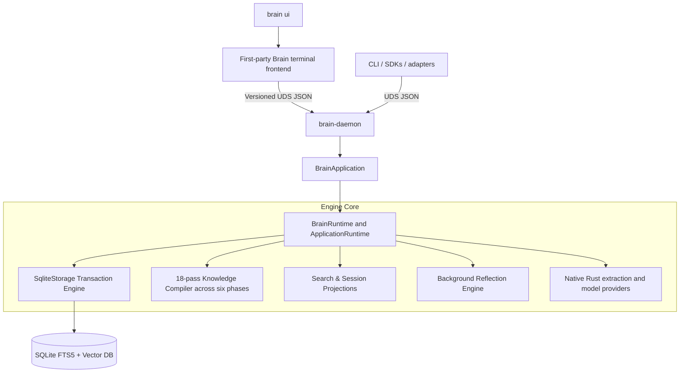

# Brain: Relational Memory Engine

[](https://github.com/ritikpathania/brain/actions/workflows/ci.yml)
[](https://github.com/ritikpathania/brain/releases)
[](LICENSE)
[](https://www.rust-lang.org)
[](docs/README.md)

**Brain** is a high-performance, stateful Relational Memory Engine designed to store, canonicalize, and query structured knowledge for autonomous coding agents and interactive console interfaces.

Operating as a local background daemon (`brain-daemon`), it exposes a Unix Domain Socket (UDS) IPC interface powering the first-party terminal frontend, Python, TypeScript and Rust SDKs, and the MCP, ACP and A2A adapters.

---

## ⚡ Quick Start

From a checkout, complete the source setup below before running these commands.

```bash
# 1. Start the background daemon
./target/debug/brain daemon start

# 2. Ingest an observation into relational memory
./target/debug/brain ingest "Knowledge compiler reconciles graph facts transactionally"

# 3. Query memory graph projections
./target/debug/brain query "compiler"

# 4. Launch interactive Terminal UI console
./target/debug/brain ui
```

---

## 📦 Installation Options

### Option A: Install via Cargo
Use the [development installation guide](docs/guides/installation.md#3-install-cli-binaries-with-cargo-development) for CLI installation and source frontend setup.

### Option B: Build from Source

Install the repository toolchain (Rust 1.99.1+), uv, CPython 3.15.2, and Bun 1.4.4.

```bash
# Clone the repository
git clone https://github.com/ritikpathania/brain.git
cd brain

# Initialize the daemon environment and the owned frontend dependencies
make setup
(cd packages/brain-frontend && bun install --frozen-lockfile)

# Build CLI and daemon into target/debug
make build-daemon
make build-brain
```

### Option C: Download Pre-Built Product Archives
For published versions, find available product archives on [GitHub Releases](https://github.com/ritikpathania/brain/releases). The [Product Distribution Guide](docs/guides/product-distribution.md) records the archive names, verification steps, and evidence for each platform.

---

## 🏗️ Architecture Overview



### System Layers
1. **Presentation Layer (`packages/brain-frontend/`)**: First-party TypeScript terminal frontend. `brain ui` launches the standalone executable from a product bundle or the Bun source entry point from a development checkout.
2. **IPC Daemon (`daemon/`)**: Non-blocking Unix Domain Socket daemon handling capability negotiation, request validation, and streamed results.
3. **Core Engine (`crates/brain-services/`)**: `BrainRuntime` owns SQLite persistence and event dispatch. `ApplicationRuntime` initializes configured extraction and model providers. `BrainApplication` exposes the capability facade.

---

## 💻 Code Usage Example

```bash
cargo run --example basic_usage -p brain-services
```

```rust
use brain_services::BrainRuntime;

#[tokio::main]
async fn main() -> Result<(), Box<dyn std::error::Error>> {
    // Initialize the runtime with a SQLite database in the working directory.
    let runtime = BrainRuntime::new("brain.db")?;

    // Capture point-in-time runtime diagnostics snapshot
    let snapshot = runtime.diagnostics_snapshot();
    println!("Runtime Status: {:?}", snapshot.health);

    runtime.shutdown()?;
    Ok(())
}
```

---

## Performance benchmarks

The [benchmark guide](docs/benchmarks/README.md) lists the suites for measuring graph retrieval, daemon startup and resource usage.

---

## 📚 Documentation Directory

* **[Documentation Index](docs/README.md)**: Main sitemap outlining all specifications and guides.
* **[Installation Guide](docs/guides/installation.md)**: Extended setup and build options.
* [System architecture](ARCHITECTURE.md) and [runtime overview](docs/architecture/overview.md) cover workspace topology and request lifecycles.
* [Engineering guidelines](GUIDELINES.md) and [agent instructions](AGENTS.md) record development and verification practices.
* The [invariant ledger](REGRESSION-PREVENTION-AND-INVARIANTS.md) records regression guards and their tests.
* **[IPC Wire Protocol Specification](docs/reference/protocol.md)**: UDS socket frames and JSON RPC protocol.
* **[Release Checklist & Guide](docs/guides/release-checklist.md)**: Comprehensive release checklist and repository settings.

---

## 🗺️ Roadmap

- [x] **v1.0.0**: Stable `BrainRuntime` core, SQLite FTS5 hybrid search, and UDS IPC daemon.
- [x] **v1.1.0**: First-party terminal frontend, retrieval-backed context and the reflection pipeline.
- [ ] **v2.0.0**: Active-active Raft distributed consensus & WASM plugin sandbox.

See **[ROADMAP.md](ROADMAP.md)** for full milestone details.

---

## 🤝 Contributing

We welcome community contributions! Please review **[CONTRIBUTING.md](CONTRIBUTING.md)** and **[CODE_OF_CONDUCT.md](CODE_OF_CONDUCT.md)** before submitting pull requests.

---

## 📜 License

Distributed under the **MIT License**. See **[LICENSE](LICENSE)** for details.
